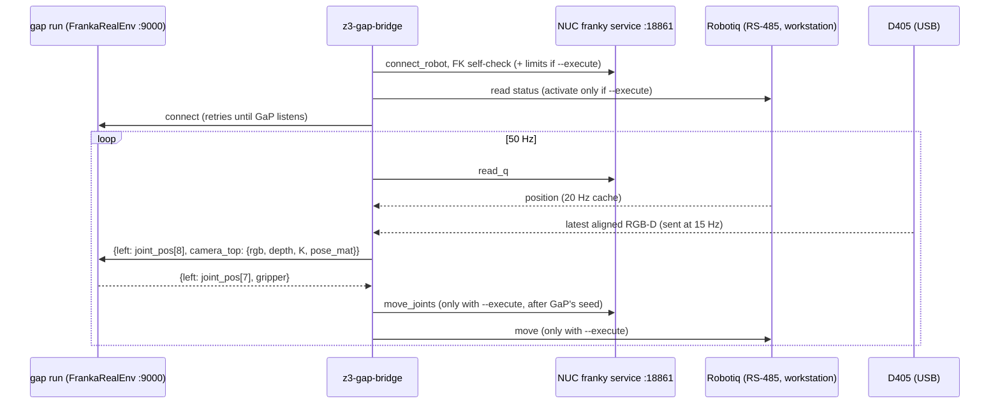

# z3_franka — run GaP graphs on the z3 cell

Connects `gap run … --real franka` to our Panda (through the NUC franky service), the
Robotiq 2F-85 (Modbus RTU on the workstation's RS-485 adapter by default, or the
NUC service's driver with `--gripper nuc`) and the wrist D405. It replaces the
`robots_realtime` rr-session client, which cannot drive our arm: it ships
`panda_python` built against libfranka 0.10.0, but our Panda (firmware 4.2.2) needs 0.9.x.
It would also open the FCI from the workstation, which conflicts with the NUC service.
**GaP itself is unchanged.** This is a separate process with its own environment, the
same way GaP treats `robots_realtime`.



| File | What |
|---|---|
| `bridge.py` | The loop, the GaP-seed gate, gripper polarity, floor guard, fault latch |
| `realsense_client.py` | D405 capture: depth aligned to colour, float32 metres, K; `z3-gap-realsense` check |
| `wire.py` | GaP's msgpack framing, client side |
| `trajectory.py` | Jerk-limited reference the bridge streams to the tracking controller |
| `handeye.py` | Eye-in-hand calibration of the wrist D405 (`z3-gap-handeye`) |
| `tcp.py` | Pivot calibration of the tool point + table height (`z3-gap-tcp`) |
| `robotiq.py` | **Verbatim** copy of the NUC service's Robotiq driver @ `c83e4ed9`, plus a read that never activates |
| `franky_client.py` | **Verbatim** copy of oktonex `okto_robot/franky_client.py` @ `c83e4ed9`. Fix it there |
| `panda_fk.py` | DH FK subset of oktonex `okto_robot/panda_fk.py` @ `c83e4ed9` |

## Setup

```bash
cd ~/graph-as-policy/bridges/z3_franka && uv sync
```

## 0. Hand tests, before GaP

| Tool | Moves anything? |
|---|---|
| `z3-gap-realsense` | No |
| `z3-gap-gripper --command status` | No |
| `z3-gap-gripper --command activate/open/close/move` | **The fingers.** Activation closes and opens them once |
| `z3-gap-fake-server` + `z3-gap-bridge` (dry run) | No. `connect` does clear robot errors and leave control mode, which interrupts any other client |
| `z3-gap-fake-server` + `z3-gap-bridge --execute` | Should not: the stand-in only ever sends GaP's seed. Proves the hold. Person at the e-stop |

## 1. Camera check (no robot, no GaP)

```bash
cd ~/graph-as-policy/bridges/z3_franka && uv run z3-gap-realsense --list
cd ~/graph-as-policy/bridges/z3_franka && uv run z3-gap-realsense --serial 409122274238 --save /tmp/d405_check
```

The check prints `K`, the timestamp domain and the centre depth, then PASS or FAIL for:
the frame rate, depth aligned to colour, at least 30 % valid depth, and the depth scale.
`/tmp/d405_check.png` shows RGB and depth side by side. The D405 only sees roughly
7–50 cm, so expect little valid depth beyond about half a metre.

## 2. The camera extrinsic (required)

`--flange-t-camera` is the 4×4 transform from the **flange** (link8) to the D405
**colour optical frame**: OpenCV convention, +z out of the lens, +y down. GaP
deprojects depth with exactly that pinhole model. Pass a `.npy` file, or a `.json`
file `{"flange_T_camera_optical": [[...], ...]}`.

**Nothing in the repo can supply this for a Robotiq mount yet.** The oktonex cell model
has the camera *body* pose for the Wuji-hand bracket only. A wrong extrinsic does not
fail; it shifts every grasp. Do a hand-eye calibration before running `--execute`.

### Hand-eye calibration (`z3-gap-handeye`, commands no motion)

The board on the table: ChArUco 11 x 8 squares, 21.2 mm squares (calipers, 2026-11-09), 15.5 mm markers, `DICT_4X4_50`,
**legacy layout** (measured on the print 2026-11-06; the modern layout fits its corners just as
well but in the wrong place — the tool's marker check rejects it). Stop the bridge first: the
camera allows one reader.

```bash
cd ~/graph-as-policy/bridges/z3_franka && uv run z3-gap-handeye
```

A live greyscale window shows the detection (corner dots green when the pose is usable, red with
the reason when not, board axes, a status bar). Hand-guide to ~15 poses with the board in view,
let go, press SPACE in the window at each (`u` undo, `s` solve, `q`/Esc solve and quit). Vary height, side
and wrist tilt (20-40 deg). Every capture is checked (stillness, corners, reprojection, marker
layout, depth vs board scale); the result is judged by where each pose puts the fixed board —
its spread in mm is the calibration error. Output: `~/z3_handeye/<stamp>/flange_T_camera.npy`
plus `report.json`. `--from-dir <dir>` re-solves saved samples.

The D405 colour stream's "inverse Brown-Conrady" coefficients behave exactly like OpenCV's
(k1, k2, p1, p2, k3) with librealsense 2.58 — checked against `rs2_deproject_pixel_to_point`
to 0.01 px. The extreme corner pixel moves 4.7 px. GaP deprojects with a plain pinhole, so
its points near the image edge carry that error.

### When the board spread will not go below several mm: the arm's own kinematics

On 2026-11-09 the two 11-06 sessions (21 poses) gave a 5.4 mm rms board spread, and
freeing the camera's intrinsics and distortion changed nothing. The arm's reported joint
angles are off: fitting zero offsets of joints 2/5/6 (`+1.77 / +0.99 / +0.52` deg, both
sessions independently) brings the held-out error to 1.1 mm. Validated the same day with
the rotor seen from 5 wrist poses: its centre disagreed by 3.2 mm rms between views with
the robot's model, 1.0 mm with the offsets. Reproduce the fit with

```bash
uv run z3-gap-handeye --from-dir ~/z3_handeye/20261106_145612 ~/z3_handeye/20261106_150621 \
    --fit-joints 2 5 6 --out-dir ~/z3_handeye/combined_kinfit
```

The result directory carries the offsets (report.json) and a camera transform that is only
right together with them. The bridge applies both with `--kinematics ~/z3_handeye/combined_kinfit`
(instead of `--flange-t-camera`): every joint reading sent to GaP gets the offsets added
and every GaP target gets them subtracted, so GaP, its IK, the floor guard and the camera
pose all work in the corrected model while the robot keeps its own angles and limits.
Record poses for such a graph with `z3-gap-joints --kinematics <same dir>`; joint poses
recorded without it are in the robot's frame and land elsewhere.

Whether the offsets are constant zero errors or depend on the pose (deflection) is still
open: `z3-gap-kincal` settles it without the camera (`parts` writes a cone cup and a ball
on a stem to print; `capture` records the ball hand-guided into the cone from many
configurations; `solve --files ...` fits the offsets — the ball centre must come out at one
point). It also measures the real tool point. Joints 1 and 7 are not measurable either way
and do not matter for camera-relative work.

### Tool point and floor guard (`z3-gap-tcp`, commands no motion)

The z3 Robotiq has custom fingertips, so GaP's stock tool point (0.157 m) is wrong, and the
floor guard's `-0.045 / 0.20` pair belongs to the previous cell: on 2026-11-06 the hand-eye
board put the table at z = +0.017 m in the base frame, 6 cm above that floor. Measure both:

```bash
cd ~/graph-as-policy/bridges/z3_franka && uv run z3-gap-gripper --command close
cd ~/graph-as-policy/bridges/z3_franka && uv run z3-gap-tcp
```

Rest the closed fingertips on ONE marked table point from 6-10 wrist tilts (20-40 deg
forward/back and sideways), Enter at each. It prints `GAP_FRANKA_TCP_FLANGE_M` for GaP (FK and
IK both read it — see GaP's `gap/env_config.py`) and `--tool-length-m` / `--z-floor-m` for the
bridge. The TCP found is the fingertip END; GaP's grasp `z_offset` (-0.04) is then the fingertip
depth below the object's top.

## 3. Dry run (no motion)

Terminal 1, GaP (validate first, then wait for the bridge):

```bash
cd ~/graph-as-policy && uv run gap run examples/real_franka_pick_place/graph --validate-only
cd ~/graph-as-policy && uv run gap run examples/real_franka_pick_place/graph --real franka --no-rr-autostart
```

Terminal 2, the bridge (z3 cell, 2026-11-09: the corrected kinematics, see the hand-eye section;
`--z-floor-m 0.008` because the table is at z = 4.6 mm in that model, not 16.9):

```bash
cd ~/graph-as-policy/bridges/z3_franka && uv run z3-gap-bridge --kinematics ~/z3_handeye/combined_kinfit --z-floor-m 0.008 --gripper nuc
```

GaP's `wait_ready` should pass and perception should run. Every arm target and gripper
command GaP issues is logged as `DRY RUN …` and never sent. GaP's motion waits time out
because the arm does not move; that is expected. In a dry run the bridge writes nothing
to the controller and never activates the Robotiq (activation moves the fingers).

## 4. Execute — person at the e-stop

```bash
cd ~/graph-as-policy/bridges/z3_franka && uv run z3-gap-bridge --kinematics ~/z3_handeye/combined_kinfit --z-floor-m 0.008 --gripper nuc --execute
```

Every pose in a graph must be in the same model as the bridge: poses taught against the
robot's own model (a bridge with `--flange-t-camera`) land 13 mm too low under
`--kinematics`, and vice versa. `z3_graphs/poses_demo/convert_poses.py` converts.

**The NUC controller.** The default `--motion nuc` needs the franky service's POSITION
controller (one Ruckig JointMotion per GaP target, planned in the 1 kHz loop); the bridge
checks it at connect and refuses otherwise. Switch it (no motion; the arm is held by the
brakes while the service restarts — be at the robot):

```bash
cd ~/oktonex && OKTO_FRANKY_VENV=franky-env-2.0 OKTO_FRANKY_SERVICE_ARGS=" " bash packages/robot/scripts/restart_franky.sh
```

Back to the tracking controller oktonex teleop was tuned with (its exact flags, 2026-11-06):

```bash
cd ~/oktonex && OKTO_FRANKY_VENV=franky-env-2.0 OKTO_FRANKY_SERVICE_ARGS="--controller tracking --tracking-stiffness 300 200 300 300 50 100 50 --tracking-damping 30.9 30.1 30.0 70.8 5.0 9.9 5.0 --tracking-dq-lowpass-hz 0 0 0 3 0 0 0" bash packages/robot/scripts/restart_franky.sh
```

With the tracking controller, use `--motion stream` (the bridge plans and streams small steps).

**First check the motion itself with the stand-in GaP** (person at the e-stop): it turns only
the last wrist joint by 0.1 rad after 3 s and back after another 3 s.

```bash
cd ~/graph-as-policy/bridges/z3_franka && uv run z3-gap-fake-server --test-move-rad 0.1   # terminal 1
cd ~/graph-as-policy/bridges/z3_franka && uv run z3-gap-bridge --flange-t-camera ~/z3_handeye/combined_nominal/flange_T_camera.npy --gripper nuc --execute   # terminal 2
```

What the bridge does, and why:

- **Holds the arm until GaP sends a real command.** `FrankaRealEnv` seeds its action with
  a hard-coded home pose (`[0.0256, -0.5002, …, -2.346]`). Forwarding it would drive the
  arm there as soon as the bridge connects. The gripper has its own gate.
- **Inverts the gripper.** GaP uses 1 = open; the franky service uses 1 = closed.
- **Plans every GaP target itself and streams it in small steps.** The NUC runs
  `--controller tracking`: asynchronous `move_joints` only moves the reference of a 1 kHz
  impedance loop, with NO interpolation (`rel_dyn` is ignored). On 2026-11-06 GaP's whole-move
  targets (0.4-0.8 rad) went straight in: the arm jumped, reflexed, the service recovered on its
  own, and it jumped again. Now a Ruckig trajectory (`trajectory.py`; 0.7 rad/s, 0.9 rad/s^2,
  4.5 rad/s^3 via `--dynamics 0.4 0.3 0.3`) is streamed one step per tick, at most ~0.014 rad.
- **Claims supervised control** of the NUC service, so a reflex is reported as an error and
  latches the bridge's fault instead of being silently recovered. Close every other program
  connected to the service first (gripper tool, calibration tools, teleop). GaP's `move_to_joints_blocking` gives up after about 3.5 s
  and carries on. If a long move is still in progress, the next step (for example
  closing the gripper) starts early. Raise `--dynamics` or GaP's `max_steps` rather
  than accepting that.
- **Applies the kinematic correction, if given** (`--kinematics DIR`, see the hand-eye
  section): joint zero offsets between the robot's angles and the model GaP works in.
- **Clamps targets onto the floor** (`--z-floor-m 0.020` with `--tool-length-m 0.220`,
  the z3 cell measured 2026-11-06 with `z3-gap-tcp` and the hand-eye board). The clamp uses the same bisection rule as
  `FrankaPandaFranky`. It checks the target, not the path.
- **Latches on a reflex.** After a reflex, the bridge sends no further commands, does
  not recover automatically and keeps streaming state. Clear the robot, then restart
  the bridge and the graph.
- **Stops the arm on exit.** On Ctrl-C or when GaP disconnects, the bridge calls the
  service's jerk-limited `stop()`.

## Before the first `--execute`, verify

1. **The tool-centre point GaP assumes.** GaP computes the end-effector pose with a Robotiq
   tool-centre point of −0.157 m along `panda_hand` z and a π/4 z rotation
   (`gap/envs/franka_real_env.py`). Check both against our 2F-85 mount.
2. **The floor pair.** `z_floor_m` and `tool_length_m` are only valid together, and the
   defaults are from the previous cell (6 cm too low here). Set both from `z3-gap-tcp`.
3. **The payload.** Re-register the Robotiq's load in Desk / `panda_ee.toml` after swapping
   it back for the Wuji hand.
4. **Where the graph moves.** The example graph's approach heights (`approach_height` 0.35,
   `drop_clearance` 0.15) were tuned for another table. `robot.go_home` is a no-op on
   real robots, so move the arm to free space by hand.

## Tests

```bash
cd ~/graph-as-policy/bridges/z3_franka && uv run pytest -q
# + the FrankaRealEnv parse test, with GaP's light deps:
cd ~/graph-as-policy/bridges/z3_franka && uv run --with viser --with robot_descriptions --with yourdfpy --with gymnasium --with scipy --with pyyaml pytest -q tests/test_wire_against_gap.py
```

`test_wire_against_gap.py` is the positive control. It runs GaP's **own**
`MsgpackNumpyServer` and `FrankaRealEnv._convert_observation` against this client, so an
upstream change to the wire format fails here rather than on the robot.

## Robot in Reflex

`connect` fails with `Set Collision Behavior command rejected: command not possible in the
current mode ("Reflex")` when the arm is latched in a reflex and the NUC service holds no
connected `Robot` (franky sets collision thresholds when it creates one, which Reflex
rejects, so the service cannot recover it either). The bridge never recovers it for you.

1. Find out why: Desk shows the reflex reason. If the cause is still there — the arm
   resting on something, a joint at its limit — clearing it will only re-trigger.
2. Hand-guide the arm away from the cause if needed.
3. Press and release the user stop, or acknowledge the error in Desk, until the robot
   is back in its ready state (white/blue light).
4. Rerun the bridge. Its `connect` clears any remaining errors and checks the robot is Idle.

